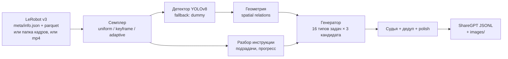

<div align="center">

# Vision-Action Data Factory

**Из эпизодов робота — в обучающие примеры «кадр → вопрос → ответ».**

Фабрика визуально-языковых данных для VLA: 16 типов задач, офлайн-пайплайн без GPU,
на выходе — ShareGPT JSONL, который ест LLaMA-Factory и SmolVLA.

<p>
  
  
  
  
  
  
</p>

<p align="center"><a href="data/final_input/libero_episode_0/frame_00000.jpg"></a><a href="data/final_input/libero_episode_0/frame_00007.jpg"></a><a href="data/final_input/libero_episode_0/frame_00015.jpg"></a></p>

_Три кадра одного эпизода симуляции LIBERO: захват, перенос, укладка. Фабрика превращает их в 12 записей — по четыре вопроса на каждый кадр._

</div>

> **Инструкция на эпизод:** `pick up the alphabet soup and place it in the basket`  
> **Вопрос к кадру 0:** что робот делает прямо сейчас?  
> **Ответ фабрики:** `Current subtask: Pick up the alphabet soup. Task progress: Step 1/2 (19%). Evidence: hand at [85,64,170,128]; container at [99,143,150,185]`

**[Демо за 30 секунд](#быстрый-старт)** · **[Пример данных](annotations.jsonl)** · **[Честный разбор результата](IMPROVE.md)** · **[Starter kit](https://github.com/overbaffe1/Vision-Action-Data-Factory/releases/tag/starter-kit-v1)**

## Зачем это

Политике нужна не одна инструкция на весь эпизод, а сигнал на каждом шаге: что в кадре,
какая фаза задачи идёт, что делать дальше, чем закончился прошлый шаг. Такая разметка
обычно делается руками, а руками она не масштабируется: 1693 эпизода LIBERO — это уже
десятки тысяч кадров.

Фабрика собирает эти пары автоматически из того, что уже есть в записи — кадров,
телеметрии действий, состояния захвата и текста инструкции. Ничего не генерируется
«из головы»: каждый ответ опирается на боксы, геометрию или разобранную инструкцию,
поэтому его можно проверить глазами.

## Что построено

1. **[Семплер кадров](src/frame_sampler.py)** — три стратегии (`uniform`, `keyframe`, `adaptive`). Адаптивная комбинирует равномерную сетку, скачки в `action`/`state` и события захвата, а слабым эпизодам досыпает кадры (`polish_worst`).
2. **[Детектор](src/detectors/yolo_detector.py) + [геометрия](src/spatial.py)** — YOLOv8 даёт боксы (`conf 0.25`, `IoU 0.45`), дальше — только арифметика: `above`/`below`/`inside`/`next to`/`close to` по координатам и IoU, позиция в сетке 3×3 («слева, у верха»), фильтр мелких объектов. Отношения дедуплицируются через `set`, поэтому в ответы не попадают повторы.
3. **[Разбор инструкции](src/subtask.py)** — rule-based декомпозиция без LLM: глагол + объект + цель превращаются в цепочку подзадач, прогресс и процент. Детерминированно, офлайн, воспроизводимо.
4. **[Судья и отбор](src/judge.py)** — на каждый кадр генерируются 3 кандидата ответа, эвристический судья выбирает лучшего, слабые записи и дубликаты отбрасываются. Именно это отличает фабрику от генератора шаблонов.

Приёмы отбора перенесены из моего проекта по [QAOA](https://github.com/overbaffe1/QAOA):
`ratchet` (лучший из N кандидатов вместо усреднения), `lottery` (поиск шаблонов),
`knn_warm` (перенос по похожим инструкциям), `polish_worst` (спуск по худшим эпизодам).
Оптимизация дискретного набора вариантов и отбор разметки — одна и та же задача.

## Как это работает



| Этап | Код | Что решает |
|------|-----|------------|
| Загрузка | [src/dataset_loader.py](src/dataset_loader.py) | LeRobot v3 (`meta/info.json`, parquet с `action`/`state`), папки картинок, видео через `cv2`; единый `Episode`/`FrameInfo` |
| Сэмплинг | [src/frame_sampler.py](src/frame_sampler.py) | сколько и каких кадров брать из эпизода |
| Восприятие | [src/detectors/yolo_detector.py](src/detectors/yolo_detector.py) | боксы объектов и захвата, батч по 8 картинок |
| Отношения | [src/spatial.py](src/spatial.py) | «где объект относительно объекта», позиция в сетке кадра |
| Смысл | [src/subtask.py](src/subtask.py) + [src/captioner.py](src/captioner.py) | подзадачи, прогресс, завершённость, причина сбоя |
| Отбор | [src/judge.py](src/judge.py) | рейтинг кандидатов, порог качества, дедупликация |
| Сборка | [generate_dataset.py](generate_dataset.py) | оркестрация, веса задач, запись JSONL и статистики |

Всего — **1 920 строк Python**, из них 519 в точке входа.

## Шестнадцать типов задач

| Группа | Типы | Что даёт модели |
|--------|------|-----------------|
| Сцена | `scene_caption`, `object_state`, `spatial_relation`, `qa_counting`, `qa_spatial` | что в кадре, в каком состоянии, где относительно друг друга |
| Действие | `subtask_current`, `subtask_next`, `qa_action`, `qa_temporal` | текущая фаза, следующий шаг, что было до кадра |
| План | `decomposition`, `progress`, `completion` | разбиение инструкции и понимание, далеко ли до конца |
| Сбой | `error_cause`, `recovery` | почему не получилось и как выкрутиться — самый дефицитный сигнал |
| Привязка | `bbox_grounding`, `pointing` | координаты и точки: язык, привязанный к пикселям |

Веса задач в [config.yaml](config.yaml) перекошены в сторону `spatial_relation`, `subtask_*` и
`bbox_grounding` — именно они работают на VLA, а не на красивый caption.

## Демо в цифрах

| | |
|---|---|
| Эпизодов на входе | **3** (2 × LIBERO + 1 smoke) |
| Кадров после сэмплинга | **23** из 39 |
| Записей на выходе | **92** (4 на кадр) |
| Уникальных вопросов | **33** из 92 записей |
| Повторов «вопрос + кадр» | **0** из 92 — дедуп по хэшу |
| Средняя длина ответа | **230 символов** |
| Время генерации | **0.1 с** на CPU |
| GPU, веса, интернет | не нужны |
| Seed | 42, `PYTHONHASHSEED=0` |

Воспроизводимость проверена буквально: две сборки подряд дают одинаковый файл
(`md5 e1c77c7223393542845f3c354a0f773b`). Статистика лежит рядом —
[annotations.stats.json](annotations.stats.json).

## Анатомия одной записи

```json
{
  "messages": [
    {
      "role": "user",
      "content": "< image>\nCarefully observe the image. What should the robot do next to complete 'pick up the alphabet soup and place it in the basket'?"
    },
    {
      "role": "assistant",
      "content": "Next subtask: Place it in the basket. After completing 'Pick up the alphabet soup', the robot should move to this step. Progress so far: Step 1/2 (19%). Evidence: hand at [85,64,170,128]; container at [99,143,150,185]"
    }
  ],
  "images": ["libero_episode_0/frame_00000.jpg"]
}
```

- `< image>` — токен-заглушка ShareGPT; LLaMA-Factory подставляет картинку по порядку из `images`.
- `Evidence: … at [x1,y1,x2,y2]` — координаты прямо из детектора. По ним ответ можно проверить, а модель учится привязывать текст к пикселям.
- `Step 1/2 (19%)` — прогресс из декомпозиции инструкции, а не выдуманное число.
- Пути к картинкам относительные — датасет переносится вместе с папкой медиа.

## Контроль качества

| Механизм | Что делает |
|----------|------------|
| **Ratchet** | 3 кандидата на задачу → судья берёт лучшего (не усреднение) |
| **Judge** | 0.15 длина · 0.25 пространственные термины · 0.20 разнообразие объектов · 0.20 покрытие инструкции · 0.20 уникальность; порог 0.4 |
| **Дедупликация** | хэш `вопрос + картинка`; опционально CLIP-эмбеддинги |
| **Polish worst** | эпизоды с низким quality получают +2 кадра и перегенерацию |
| **Стоп-фразы** | `as an AI`, `I cannot see`, `unable to determine` — сразу в брак |

Отсев видно в логе: `Judge фильтр: 92 -> 92`, `Дедуп: 92 -> 92`. На демо-эпизодах всё
проходит, на сырых источниках режется заметная часть — это нормальный режим работы.

## Быстрый старт

Linux, macOS или WSL · Python 3.10+ · без GPU и весов. Частичный клон нужен, чтобы
не тянуть архивы хакатона (~8 МБ вместо десятков).

```bash
GIT_LFS_SKIP_SMUDGE=1 git clone --depth 1 --filter=blob:none --sparse \
  https://github.com/overbaffe1/Vision-Action-Data-Factory.git
cd Vision-Action-Data-Factory
git sparse-checkout set src data/final_input

python3 -m venv .venv
. .venv/bin/activate
python -m pip install 'numpy>=1.24' 'Pillow>=10' 'PyYAML>=6'

PYTHONHASHSEED=0 python generate_dataset.py \
  --input data/final_input \
  --output /tmp/vision-action-demo/annotations.jsonl \
  --config config.yaml
```

Ожидаемый хвост лога:

```text
INFO | factory.loader | Загружено 3 эпизодов из image folder data/final_input
WARNING | factory.yolo | ultralytics не установлен — используется dummy детектор
INFO | factory     | Сэмплировано кадров: 23 (стратегия adaptive, 8 на эпизод)
INFO | factory     | Judge фильтр: 92 -> 92 (threshold 0.4)
INFO | factory     | Готово: 92 примеров в annotations.jsonl за 0.1s
```

Боксы в этом режиме синтетические: без `ultralytics` детектор уходит в dummy-fallback.
Демо показывает путь «кадры → JSONL», а не точность детекции. Поставьте
`pip install ultralytics` — и вместо заглушки заработает YOLOv8.

Чтобы получить тот же датасет на своих данных, положите корень с LeRobot-датасетами
(`meta/info.json`) в `--input`: лоадер найдёт все эпизоды рекурсивно.

## Что проверено, а чего здесь нет

Проект хакатонный, поэтому честная граница важнее красивых цифр.

| | Статус |
|---|---|
| ✅ Пайплайн работает на CPU и детерминирован | проверено: 92 записи, одинаковый md5 на повторных прогонах |
| ✅ Формат совместим с LLaMA-Factory / SmolVLA | ShareGPT JSONL с `messages` + `images` |
| ⚠️ Детектор в демо — заглушка | без `ultralytics` боксы синтетические, качество `spatial_*` на демо условное |
| ⚠️ Демо-масштаб | 92 записи — витрина механики, для SFT нужны тысячи примеров с реальных источников |
| ❌ Обученной модели в репозитории нет | в `action_expert/` лежит smoke-чекпоинт: 10 шагов на 5 эпизодах, это проверка пайплайна, а не результат |

Последний пункт разобран в [IMPROVE.md](IMPROVE.md): там сверены `train_config.json` из
сабмита с шаблоном организаторов, показано, почему счёт ~9.9 — это уровень почти
случайной политики, и расписан рецепт полного обучения (30 000 шагов на 1693 эпизодах,
self-check по `libero_spatial`, отбор чекпоинта).

## Контекст хакатона

Задача трека — обучить пару **SmolVLM2-500M-Video-Instruct → SmolVLA** на LIBERO и
сдать `submission/`, где итог считается как `Score = 100 · (0.4·VLM + 0.6·VLA)`.
Моя часть — данные: генератор разметки, диагностика базовой линии, упаковка и доставка
сабмита, инструкция для запуска на чужой машине.

- **[Исходный PR участия](https://github.com/overbaffe1/Vision-Action-Data-Factory/pull/1)** — генератор, упаковка, разбор baseline.
- **[IMPROVE.md](IMPROVE.md)** — почему счёт такой, что обучать и в каком порядке.
- **[Starter kit](https://github.com/overbaffe1/Vision-Action-Data-Factory/releases/tag/starter-kit-v1)** — архив с фабрикой и [пошаговой инструкцией](starter/START_HERE.txt) под WSL2.
- **[Архивная сборка сабмита](https://github.com/overbaffe1/Vision-Action-Data-Factory/releases/tag/submission-final-20261018-2216)** — две части и порядок склейки; внутри smoke-чекпоинт, оставлен как история.

## Структура репозитория

```text
generate_dataset.py      точка входа: оркестрация, веса задач, запись JSONL
src/                     семплер, лоадер, детектор, геометрия, подзадачи, судья
config.yaml              стратегия сэмплинга, 16 задач, веса, пороги качества
data/final_input/        3 демо-эпизода: 39 кадров (32 LIBERO + 7 smoke)
annotations.jsonl        результат демо: 92 записи (+ annotations.stats.json)
IMPROVE.md               разбор счёта и план полного обучения
aij_robotics-main/       стартовый kit организаторов: SmolVLM2 → SmolVLA, Docker, self-check
starter/                 что получает человек с чужой машины: инструкция и конфиг
action_expert/           smoke-артефакты сабмита (не рабочая модель)
.github/workflows/       сборка starter kit, упаковка сабмита, доставка весов
espada-feat-bpc-tz-production-scale/  соседний проект по spatial-разметке — источник идей фильтрации
baseline.zip, participant.zip          архивы baseline и участия
```

## Стек

`Python 3.10+` · `numpy` · `Pillow` · `PyYAML` · `ultralytics` (YOLOv8, опционально) ·
`pyarrow` / `pandas` (LeRobot parquet) · `opencv` (видео) · `open_clip` (retrieval,
опционально) · `LLaMA-Factory` и `SmolVLA` на стороне обучения.

---

**Что дальше.** Демо закрывает механику; следующий шаг — прогнать фабрику по четырём
разрешённым источникам (BridgeData2, Fractal, Language Table, Egocentric-100K), получить
тысячи примеров и обучить VLM на них. План и команды — в [IMPROVE.md](IMPROVE.md).

## Лицензия

Код фабрики — [MIT](LICENSE): `generate_dataset.py`, `src/`, `config.yaml`, `starter/`,
`.github/`. Берите и используйте, ссылка на репозиторий приветствуется.

Материалы хакатона лицензией MIT не покрываются и живут по своим условиям:

- `aij_robotics-main/` — стартовый kit организаторов, отдельного LICENSE в нём нет: права остаются у авторов оригинала;
- `espada-feat-bpc-tz-production-scale/` — MIT © 2026 Sberbank, текст в [LICENSE](espada-feat-bpc-tz-production-scale/LICENSE) внутри папки;
- `baseline.zip`, `participant.zip`, `action_expert/`, `smolvlm2/` — архивы организаторов и smoke-веса моделей: только для воспроизведения сабмита, не для переиспользования.
